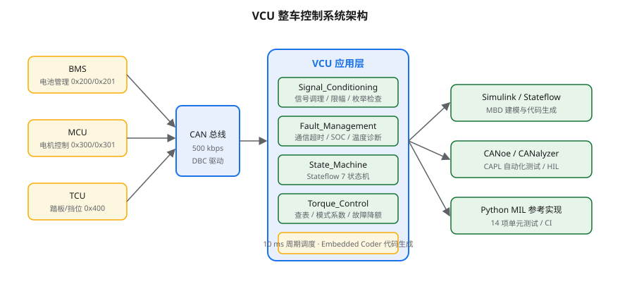
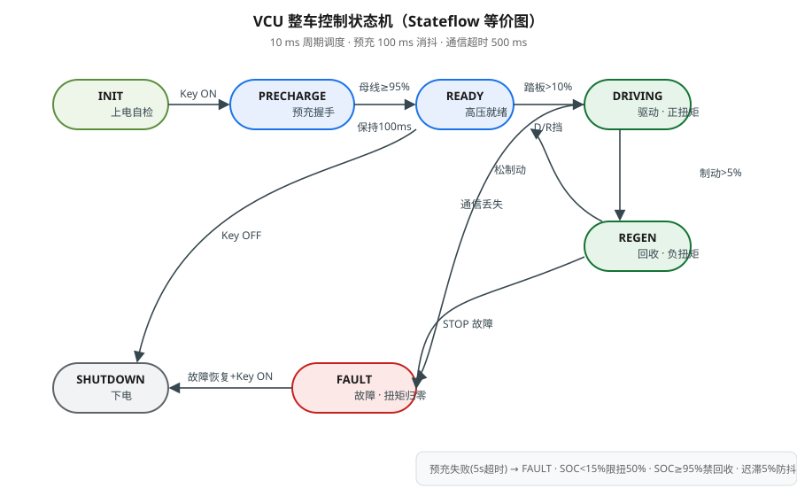

# VCU 整车控制器控制策略与 CAN 通信矩阵

> 基于模型开发（MBD）的整车控制器参考实现：Simulink/Stateflow 状态机 + CAN DBC 通信矩阵 + CANoe/CAPL 自动化测试 + Python 在环验证。面向新能源汽车 VCU / 整车控制软件开发岗位。

[](test/test_report.txt)
[](dbc/VCU_Matrix.dbc)
[](#-工具链与文件对应)
[](LICENSE)

---

## 一眼看懂这个项目

**这是整车控制器的"应用层 + 通信层 + 测试层"完整工程**：VCU 作为新能源汽车的顶层控制器，协调 BMS（电池）、MCU（电机）、TCU（踏板挡位）三大节点，实现上下电预充握手、驱动扭矩管理、制动能量回收和故障诊断。



## 核心亮点

- **7 状态整车状态机**：`INIT → PRECHARGE → READY → DRIVING / REGEN → FAULT → SHUTDOWN`，含预充 100 ms 消抖、5 s 超时保护、故障优先级与恢复路径
- **完整 CAN 通信矩阵**：8 个报文 / 39 个信号 / 4 个 ECU 节点，含周期、发送方、字节序、物理值与枚举定义，可被 CANoe/CANalyzer 直接导入
- **三级扭矩控制**：踏板查表 MAP（10% 死区）+ 驾驶模式系数（ECO/NORMAL/SPORT）+ 故障降额与限幅
- **功能安全思维**：通信 500 ms 超时判故障、SOC 15%/20% 迟滞防抖、SOC ≥ 95% 禁止回收、故障码 16 bit 可追溯
- **V 模型全流程**：需求(SRS) → 设计(SDD) → 建模 → MIL 测试 → HIL 测试，需求到用例双向可追踪

## 状态机



## 快速开始

```bash
# 1. 校验 DBC 通信矩阵并导出信号清单（零依赖）
python tools/dbc_parser.py dbc/VCU_Matrix.dbc

# 2. 运行 MIL 参考实现，打印状态迁移与扭矩
python src/vcu_core.py

# 3. 运行 14 项控制策略单元测试
python -m unittest discover -s test -v
```

预期输出：`Ran 14 tests ... OK`、`结果: PASS`。

在 MATLAB 中运行 `model/build_model.m` 可一键生成 Simulink 模型骨架（含 Stateflow 状态）；
在 CANoe 中导入 `dbc/VCU_Matrix.dbc` 并加载 `canoe/VCU_Test.capl` 可运行 5 项 HIL 自动化测试。

## 工具链与文件对应

| 工具 | 本项目文件 | 用途 |
|---|---|---|
| MATLAB / Simulink | `model/build_model.m` | 一键生成应用层模型架构（10 ms 定步长） |
| Stateflow | `model/images/state_machine.svg` | 7 状态迁移图（与参考实现一致） |
| CANoe / CANalyzer | `canoe/VCU_Test.capl` | 5 项自动化测试：预充/扭矩/回收/故障注入/SOC |
| DBC | `dbc/VCU_Matrix.dbc` | CAN 通信矩阵，Vector 工具链直接导入 |
| Python | `src/vcu_core.py` + `test/` | 可执行规格与 MIL 单元测试（CI 可跑） |

## 目录结构

```
vcu-control-strategy/
├── README.md                      本文件
├── LICENSE                        MIT
├── docs/
│   ├── 01_需求规格说明.md          13 条功能需求 + 需求追踪矩阵
│   └── 02_软件设计说明.md          架构 / 模块 / 调度 / 标定参数
├── dbc/
│   ├── VCU_Matrix.dbc              CAN 通信矩阵（8 报文 / 39 信号）
│   └── VCU_Matrix_signals.csv      工具自动导出的信号清单
├── model/
│   ├── build_model.m               一键生成 Simulink 模型
│   └── images/
│       ├── architecture.svg        系统架构图
│       └── state_machine.svg       状态机图
├── src/
│   └── vcu_core.py                 控制逻辑参考实现（可执行规格）
├── test/
│   ├── test_vcu.py                 14 项单元测试
│   └── test_report.txt             测试报告
├── canoe/
│   └── VCU_Test.capl               CANoe 自动化测试脚本
└── tools/
    └── dbc_parser.py               DBC 解析与矩阵检查工具
```

## 关键参数

| 参数 | 值 | 说明 |
|---|---|---|
| 控制周期 | 10 ms | 与 VCU_Status / TorqueCmd 周期一致 |
| CAN 波特率 | 500 kbps | BMS/MCU/TCU 三节点 |
| 预充阈值 | 95% × 电池电压，保持 100 ms | 防止虚电压误判 |
| 预充超时 | 5 s | 超时进 FAULT |
| 最大驱动扭矩 | 1200 Nm（D 挡） | R 挡 800 Nm，P/N 挡 0 |
| 最大回收扭矩 | 300 Nm | SOC ≥ 95% 禁止 |
| 通信超时 | 500 ms | 超时判 STOP 故障 |
| SOC 限扭 | < 15% 降额 50%，20% 恢复 | 5% 迟滞 |

## 测试覆盖

| 类别 | 用例数 | 例子 |
|---|---|---|
| 上下电时序 | 3 | 预充握手、电压不足不进 READY、Key OFF 下电 |
| 扭矩控制 | 4 | 踏板死区、MAP 插值、SPORT 系数、P 挡零扭矩 |
| 能量回收 | 2 | 制动进 REGEN、SOC 高禁回收 |
| 故障诊断 | 5 | 通信丢失 STOP、SOC 限扭、迟滞、故障恢复、过温降额 |

## 说明

本项目为**基于量产 VCU 开发流程的参考实现**，用于展示 MBD 工具链与整车控制策略的工程化方法。
Python 参考实现是可执行的控制规格，与 Simulink/Stateflow 模型逻辑一致，可在无 MATLAB 环境下完成回归验证。
CAPL 脚本需配合 CANoe 与 Vector 硬件（或 Virtual Bus）运行。

## License

MIT
